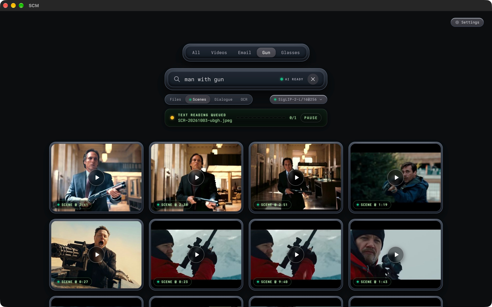

<p align="center">
  <a href="https://scm.allenlee.site/">
    
  </a>
</p>
<h1 align="center">
  <a href="https://scm.allenlee.site/" style="color: inherit; text-decoration: none;">SCM</a>
</h1>

<div align="center">
    
</div>


---

# SCM — Screen Memories

  Deep AI search for every photo and every frame of video in any folder on macOS.
  Local-first — no accounts, no cloud, no uploads. Inference runs on your Mac.

## What makes it different**

- **Search like you think** — describe a memory in plain language; a local
  vision model does the rest.

<div align="center">
    
</div>
  
- **Video, down to the moment** — scenes are segmented and embedded, so you
  land on the shot, not just the file.
- **Text and dialogue too** — OCR over visible text; exact spoken-line search
  via Whisper, each as its own mode.

<div align="center">
    
</div>

- **Your tabs, your prompts** — save any query as a tab; Screenshots and
  Email tabs are toggleable.
- **Self-maintaining library** — watched folders auto-import, content hashes
  dedupe renames, and model switches re-embed in the background without
  blocking search.
- **100% private** — your media never leaves the machine. Weights download
  once; everything after that is offline.


## Five ways to search

<div align="center">
    
</div>

| Mode                | Finds                                                                                     |
| ------------------- | ----------------------------------------------------------------------------------------- |
| **Files**           | Whole photos/videos by meaning — vision rank with filename and phrase boosts              |
| **Scenes**          | Moments inside video — search a shot, jump to its timecode                                |
| **OCR**             | Text visible in images and frames, matched literally (Tesseract; eng + 35 language toggles) |
| **Dialogue**        | Exact spoken words in videos (Whisper), tiered exactness                                  |
| **LLMs** _(opt-in)_ | Local chat over the dialogue, OCR, and filenames your Mac already extracted — cited answers |

---


## Download

The easiest install is via Homebrew (Apple Silicon, macOS 12+). The tap's
cask clears the macOS quarantine flag automatically on every install and
upgrade, so the app launches with no manual Gatekeeper steps:

```bash
brew tap allenv0/scm
brew trust --cask allenv0/scm/scm
brew install --cask scm
```

Upgrades:

```bash
brew upgrade --cask allenv0/scm/scm
```

## Development

```bash
bun run dev     # build the renderer bundle, then launch the Electron app
bun start       # launch the Electron app without rebuilding
bun run build   # just rebuild the renderer bundle into dist/
```
